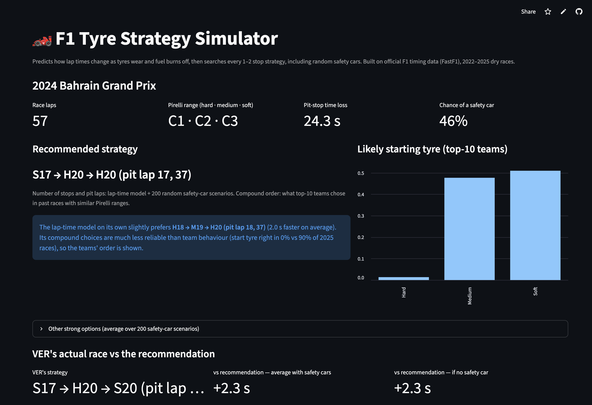
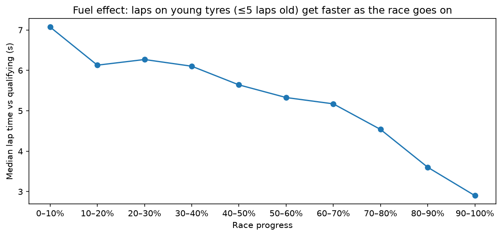
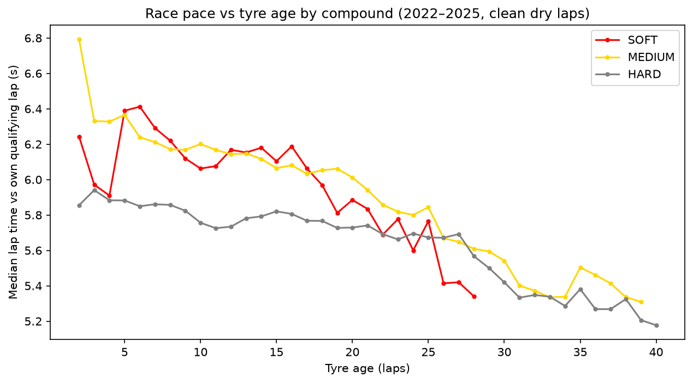
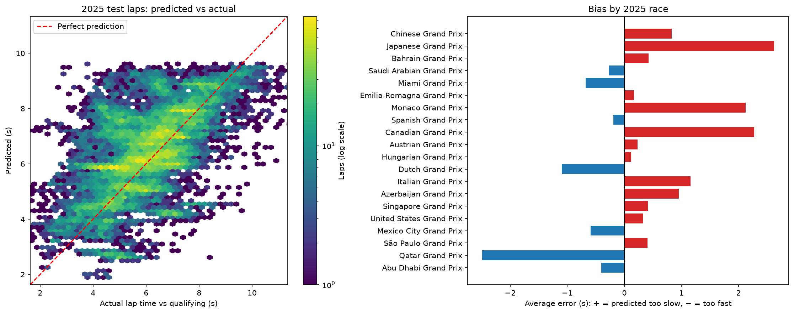
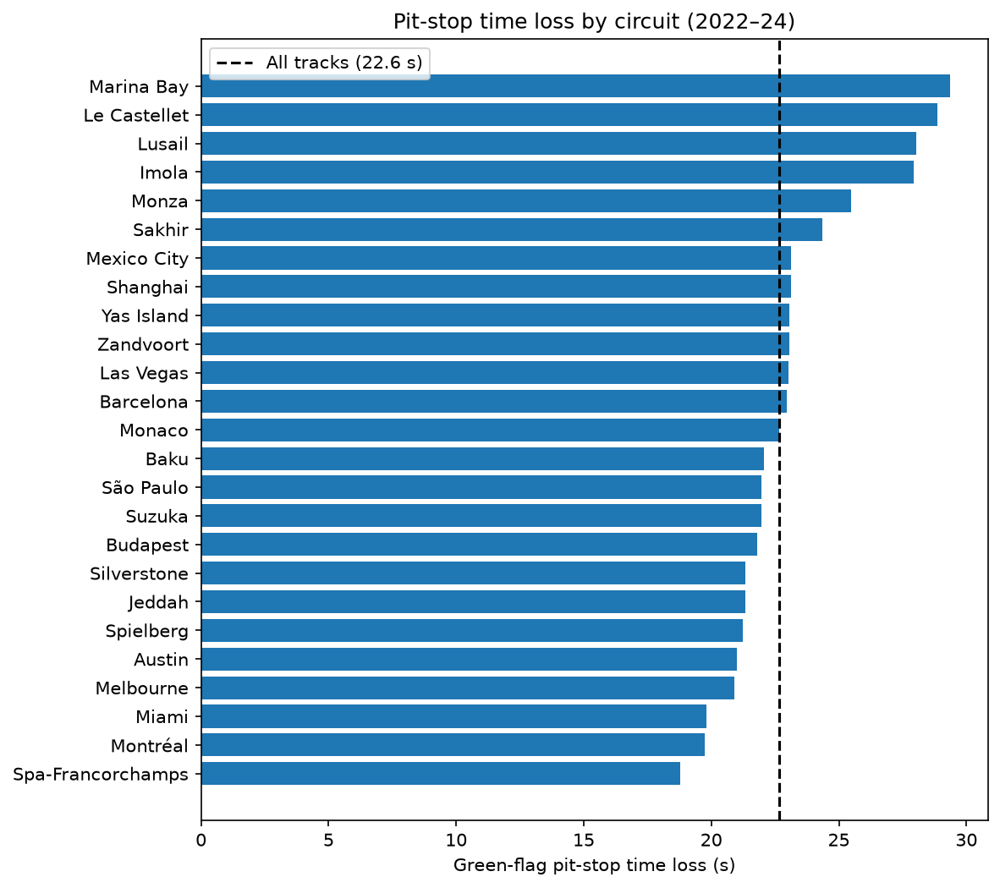

# 🏎️ F1 Tyre Strategy Simulator

**Predicts Formula 1 lap times as tyres wear and fuel burns off, then searches every 1–2 stop pit strategy — including random safety cars — and recommends when to pit.**

**[▶ Try the live app](https://stintmodel.streamlit.app)** · Built with Python, scikit-learn, FastF1 and Streamlit · Data: 2022–2025 seasons



---

## Results at a glance

| Question | Result (tested on the unseen 2025 season) |
|---|---|
| How accurately does it predict a lap? | **1.10 s** average error vs **1.31 s** for a track + tyre baseline (**15.8% better**) |
| How much of that error matters for strategy? | Only **0.50 s/lap** — 76% of the error is a fixed offset per driver per race, which cancels when comparing strategies |
| Does it pick the right number of pit stops? | Matched the top-10 majority in **60%** of races vs **30–35%** for history-based baselines |
| Does it pick the right starting tyre? | **90%** of races (a pure lap-time simulator: **0%**) |
| How close is the predicted total race time? | Within **1.02%**; **11 s** when comparing drivers within the same race |

---

## What it does

Pick any dry race from 2022–2025 and a driver. The app:
1. predicts every lap of every legal 1- or 2-stop plan from a **lap-time model** (tyre age, compound, fuel load, circuit, temperature);
2. adds each track's **measured pit-stop time loss**;
3. re-ranks plans over **200 random safety-car / VSC scenarios** (a stop under a safety car costs ~36% less);
4. takes the **compound order** from a model of what top-10 teams chose, given **Pirelli's compound range** for that race;
5. compares the recommendation with **what the driver actually did**, lap by lap.

## Data

- **FastF1** official timing data: **92 races, 101,291 laps** (2022–2025), plus qualifying lap data for every session.
- **Pirelli compound nominations** for 91 of 92 races, **built by hand from Pirelli press releases and race previews** (`reference/pirelli_compounds.csv`, every row with its source link) — FastF1 only says "SOFT/MEDIUM/HARD", not which actual compound (C1–C6) that was.
- After removing wet races, wet qualifying, pit laps, safety-car/VSC laps, yellow flags and outliers: **67,823 clean dry laps** (every rule and its count is in notebook 02).

## Approach

| Stage | Notebook | What |
|---|---|---|
| Setup | `00_setup_check` | Environment, data checks against known results |
| Success criteria | `docs/success_criteria.md` | Target, baselines, metrics and a 15% goal written **before** modelling |
| Exploration | `01_eda` | Fuel effect, tyre-wear confounding, safety-car rates |
| Cleaning & features | `02_features` | Leakage-safe rules, qualifying reference, features |
| Modelling | `03_modelling` | Baselines → linear / random forest / gradient boosting; test season used once |
| Insights | `04_insights` | What drives predictions, where it fails |
| Strategy | `05_strategy_simulation` | Pit losses, calibration, Monte Carlo safety cars, team-choice model, 2025 back-test |
| App | `app/app.py` | Streamlit app, deployed on Streamlit Community Cloud |

**Key design decisions**
- **Target = lap time minus the driver's own qualifying lap.** This removes track length and car pace, leaving fuel, tyre wear and conditions. Qualifying happens before the race, so it's leakage-safe.
- **Split by season, never randomly:** train 2022–23, validate 2024, test 2025 once. A random split would let lap 20 teach the model about lap 21 of the same stint.
- **Wet qualifying detected from qualifying data, not race results** — choosing which races to keep using race outcomes would itself be leakage.

## Results

### Lap-time model

| Model | 2024 validation MAE | 2025 test MAE |
|---|---|---|
| B0: one constant | 1.383 s | — |
| B1: median by track + compound | 1.037 s | 1.306 s |
| Random forest | 0.922 s | — |
| Gradient boosting (tuned, monotonic in tyre age) | 0.837 s | — |
| **Ridge + compound & circuit wear terms (final)** | **0.809 s (−22.0%)** | **1.100 s (−15.8%)** |

With only 33 training races, **the simplest model generalised best**. It learned physically sensible effects: about **+0.045 s/lap of tyre wear** and **0.05–0.07 s/lap gained as fuel burns off**.



**Confounding:** a naive chart makes old tyres look *faster* — because long stints happen later in the race, on less fuel, and only where tyres hold up (survivor bias). The model separates tyre age from fuel load.





### Strategy

- **Pit loss:** 22.65 s on average (Spa 18.8 s → Singapore 29.4 s); **14.5 s under a safety car**, 15.6 s under a VSC.
- **Safety cars:** 56% of 2022–24 races had one; per-track chances are blended with the average so 3 races can't produce 0% or 100%.



**2025 back-test (20 dry races, tested once):**

| | Model | Lap-time simulator alone | Circuit history | Most common overall |
|---|---|---|---|---|
| Number of stops (vs top-10) | **60%** | 60% | 30% | 35% |
| Starting tyre | **90%** | 0% | 95% | 80% |
| Full compound order | 40% | 0% | 40% | 40% |

Several misses have clear causes: **one-off 2025 rules** (two mandatory stops at Monaco; tyre-life limits in Qatar), a **FastF1 stint-numbering glitch** in Montréal, and **risk preference** — when a 1-stop and a 2-stop are close, teams choose the safer 1-stop, while the model picks the faster average.

## What went wrong — and what I learned

| Problem | How I found it | What I did |
|---|---|---|
| A search for "RED FLAG" matched "CHEQUERED FLAG" | Tested on a race I knew had no red flag | Used exact category columns instead of text search |
| A timing glitch produced a 73.7 s qualifying "lap" at Jeddah (pole: 88.2 s) | Printed a sanity number for every race downloaded | Kept only laps whose sector times add up to the lap time |
| My first wet-qualifying rule used race results | Realised it was leakage while planning | Flagged wet qualifying from qualifying data only |
| The most accurate model gave every compound the same wear rate — a simulator would always pick softs | Plotted its wear curves instead of trusting MAE | Measured wear directly from same-race comparisons; added a calibration |
| A "better" model I designed lost my own pre-set test | Decision rule written before seeing results | Kept the simpler model and documented the experiment |
| Data said a safety-car pit stop saved nothing | It contradicted F1 knowledge, so I questioned the measurement | Measured up to the restart, not just 2 laps: 14.5 s vs 22.65 s |
| Calibration said 36-lap-old tyres were 0.9 s faster than predicted | Asked why such long stints exist: only tyres that last well get run that long | Capped corrections at 30 laps (selection bias) |
| A 92-race Pirelli dataset I built didn't beat a simple "most common choice" rule | Compared it against baselines | Reported it honestly: real pattern, but teams are already very predictable |
| The app compared plans under different assumptions | A confusing chart | Compared both plans on the same 200 safety-car scenarios |
| Deployment failed on a dependency conflict | Read the install log | Pinned versions from the current environment and ran `pip check` |

## Limitations

- **Dry races only**; 19 of 92 races were excluded for wet running or wet qualifying.
- **1–2 stop plans only**; race-specific rules (mandatory stops, tyre-life limits) aren't modelled.
- **No traffic, overtaking, tyre management or team orders**; fuel load isn't published, so laps remaining is used as a proxy.
- **Season-to-season shift:** the model was 0.29 s too fast on 2024 and 0.38 s too slow on 2025 — this cancels within a race but not in absolute lap times.
- **Unseen circuits** (Montréal in 2025) are less reliable; at most 4 races per circuit.
- **No risk preference:** the simulator picks the best average plan; teams favour a 1-stop when it's close.

## Next steps

- Use **Friday practice long runs** to measure each compound's pace and wear at each event (what teams actually do).
- Add a **risk preference** (e.g. prefer fewer stops unless clearly faster) and **3-stop** plans.
- Encode **race-specific rules** such as mandatory stops and maximum stint lengths.

## Run it locally

```bash
git clone https://github.com/Astargame/f1-tyre-strategy-simulator.git
cd f1-tyre-strategy-simulator
python3 -m venv .venv
source .venv/bin/activate
python -m pip install -r app/requirements.txt
python -m streamlit run app/app.py
```

To rebuild everything from raw data: `python src/download_data.py`, `python src/download_quali.py`, then run notebooks 00–05 in order (the downloads take about an hour because of FastF1's rate limit).

## Project structure

```
app/                 Streamlit app, its data files and pinned requirements
docs/                Success criteria written before modelling
models/              Saved lap-time model, team-choice model, strategy parameters
notebooks/           00 setup → 05 strategy simulation
reference/           Pirelli compound nominations (with sources)
reports/figures/     Charts used in this README
src/                 Download scripts, feature class, simulator
```

---

*Built by Brandon Richardson — Computer Science & AI, Loughborough University.*
